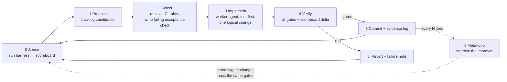

# Closed-loop recursive improver

Status: design. This document specifies an agent-driven loop that improves
hwatu using hwatu's own definition of improvement, with hwatu itself as part
of the measurement instrument. It composes three existing documents rather
than replacing them:

- [`VISION.md`](../VISION.md) is the **constraint set** (never optimized away).
- [`docs/roadmap.md`](roadmap.md) and the track roadmaps are the **proposal
  source**.
- [`docs/continuous-improvement.md`](continuous-improvement.md) is the
  **ranking rubric** the selector reuses verbatim.

## What "improve" means, operationally

A change is an improvement iff it moves the scoreboard without violating a
gate. Both are machine-checkable.

### Scoreboard (maximize / minimize, soft targets)

| Metric | Source | Direction |
| --- | --- | --- |
| activation fixture pass | `hwatu doctor` + `demo` + `check <fixture>` on a clean profile | must pass |
| E2E suite pass count | `scripts/test-*.sh` in private XDG dirs | maximize |
| warm check latency p50/p95 | `scripts/bench-spawn.sh`, `bench-render.sh` | minimize |
| tokens per verification | `scripts/bench-tokens.mjs` | minimize |
| calls per verification task | agent-loop fixture transcript length | minimize |
| snapshot context bytes | `test-snapshot-budget.sh` | bounded |
| daemon idle + per-view RSS | `scripts/soak-daemon-rss.sh` (short mode) | bounded |
| clippy/deny findings | `cargo clippy`, `cargo deny check` | zero |
| capability honesty | unsupported ops return structured errors (conformance fixtures) | must pass |

The scoreboard is emitted as one JSON file per iteration
(`improver/state/scoreboard-<iter>.json`) so deltas are diffable and the
meta-loop can audit which changes moved which numbers.

### Gates (hard, binary, non-negotiable within an iteration)

1. `cargo test && cargo clippy` green.
2. Golden IPC fixtures: protocol stays additively compatible.
3. Focus-safety: `test-headless-focus.sh` green (invisible until needed).
4. No benchmark regression beyond tolerance (default +5% p50, +10% p95).
5. Constitution lint: portable crates/modules import no GTK/GLib/Cocoa types;
   no new dependency that `deny.toml` rejects; no tabs/sync/extension-platform
   surface area.
6. Linux stays the reference: on a macOS host, gates 1-4 run inside the
   repo `Dockerfile` image as well as natively where possible.

A red gate means **revert, log, and move on**. The loop never weakens a gate
in the same iteration that needs it weakened.

## The loop

### 0. Sense

Run the full measurement harness and emit the scoreboard. The harness is
`scripts/improver/gates.sh`: it builds release binaries, runs the E2E scripts
in isolated XDG dirs (they already support this), runs benchmarks, and writes
JSON. First run on a branch establishes the baseline; later runs diff
against it.

### 1. Propose

Candidates come from, in priority order:

1. **Red or flaky harness entries** (correctness bypasses scoring, per the CI
   playbook).
2. **Benchmark drift** against the last published `docs/benchmarks.md`
   numbers.
3. **Open roadmap items** in `roadmaps/verification.md` (P0→P3), then
   `platform.md`, then `browser.md`, respecting "agent inner loop wins".
4. **User evidence**: open issues and use reports, labeled by funnel stage.
5. **Code health**: clippy/deny findings, `TODO`/`FIXME` scan, dead fixtures.

Each candidate is a file in `improver/backlog/` with: title, funnel stage,
rubric scores (frequency, activation, fit, confidence, cost, 0-3 each), the
roadmap line it serves, and a **falsifiable acceptance check** (a test name
or a benchmark delta that currently fails).

### 2. Select

Pick the highest `frequency + activation + fit + confidence + cost` item
whose cost score is ≥2 ("less than one focused day"). Before any
implementation, the acceptance check must exist and **fail**. No failing
check, no selection. This is what keeps the loop closed instead of vibes.

### 3. Implement

A worker agent (fresh context, e.g. a swarm spawn) receives only: the backlog
item, the failing check, the constitution summary, and the relevant source
files. It makes one logical change, regression test first, matching
`CONTRIBUTING.md`. The coordinator never implements and verifies the same
change with the same context; implementer and verifier are separate agents
(mirrors the vision's two-sided gates rule).

### 4. Verify

Verifier agent runs `gates.sh`, compares scoreboard to baseline, and checks
the acceptance check now passes. It reproduces claims rather than trusting
the implementer's report.

### 5. Decide and record

- Green: commit with the backlog ID in the message, append to
  `improver/state/log.md`: what changed, why, measured delta, evidence
  commands. Close the backlog item.
- Red: revert, append a failure note (what was tried, which gate fired).
  Failure notes are proposal input for the next Sense pass, so repeated
  failures either get decomposed or demoted.

### 6. Meta-loop (the recursive part)

Every N iterations (default 5), a review agent audits `improver/state/log.md`
and improves the improver itself:

- **Escape analysis**: did any regression reach `main` past a gate? Add the
  missing fixture or tighten the tolerance.
- **False-revert analysis**: did a gate fire on a change that was actually
  fine? Loosen with evidence, never preemptively.
- **Scoring calibration**: which rubric categories predicted real scoreboard
  movement? Reweight the selector.
- **Harness cost**: if Sense takes too long, the meta-loop is allowed to
  optimize the harness (caching builds, tiering fast/slow gates) because the
  harness is in-repo and passes the same gates.

Harness, gate tolerances, and scoring weights all live in-repo
(`scripts/improver/`, `improver/policy.toml`) precisely so the same loop can
version and improve them. The one thing the meta-loop may not touch is the
constitution: `VISION.md`'s product constitution and "What we will not do"
are terminal constraints, changeable only by a human.

## The recursive coupling: hwatu verifies hwatu

The improver dogfoods the product as its own instrument:

- Gate fixtures use `hwatu check` and pixel diffs against committed baselines
  for hwatu's own docs pages and demo fixtures.
- The agent-loop benchmark ("calls per verification") is measured by driving
  the freshly built `hwatu` binary through a scripted verification task.
- Therefore every improvement to snapshot quality, latency, or context
  budget immediately sharpens the loop that produced it. Instrument drift is
  caught because the previous release's binary double-checks pixel baselines
  when a diff gate fires (two-instrument rule).

## Safety and human boundaries

- The loop commits locally and pushes to an `improver/` branch; merging to
  `main` and releasing stay human actions.
- No gate weakening, dependency policy change, protocol breakage, or
  constitution edit without a human in the loop.
- Public claims (README numbers, benchmarks.md) are only updated when the
  harness re-measured them on the reference platform.
- Budget: each iteration is bounded (one backlog item, one revert max). If
  the same item fails twice it is decomposed or escalated to a human, not
  retried blindly.

## Execution mapping (jcode)

- **Coordinator**: one jcode session owns Sense/Propose/Select/Decide and the
  state directory.
- **Workers**: `swarm spawn` for implementer and verifier, separate contexts.
- **Cadence**: `ScheduleWakeup` for weekly runs matching the CI playbook, or
  run-until-budget for burst sessions.
- **Platform**: macOS host runs the mac-wkwebview daemon natively for
  verification-instrument fixtures; Linux reference gates run in the repo
  Docker image (`target-linux/` already exists for this).

## Bootstrap order

1. Land `scripts/improver/gates.sh` + `improver/policy.toml` (tolerances,
   weights, iteration budget).
2. Run Sense once, commit baseline scoreboard.
3. Seed `improver/backlog/` from current roadmap P0s and any red harness
   entries.
4. Run three supervised iterations end to end before unattended cadence.
5. Enable the meta-loop only after the first five logged iterations exist.
